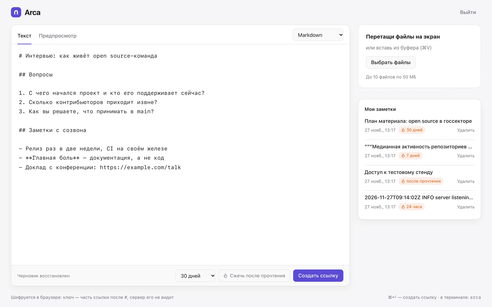

# Arca

Сервис для быстрых заметок, которыми можно поделиться. Записал мысль, пост, правку или задачу, кинул скриншот — получил ссылку. Заметка живёт 30 дней и сгорает. Всё шифруется на клиенте: сервер на своём VPS не видит ни текста, ни файлов, ни заголовков.

---

## Для кого

- Пишут: ты и пара доверенных людей, у каждого свой код доступа
- Читают: все, кому отправили ссылку, без регистрации и аккаунтов

## Типичные сценарии

- Отправить черновик или фрагмент статьи коллеге на вычитку
- Поделиться находкой из OSINT-исследования, таблицей или выгрузкой, не оставляя её в мессенджере
- Передать скриншот или PDF, который сам исчезнет через день или неделю
- Опубликовать заметку прямо из nvim или терминала
- Дать ИИ-агенту способ отдавать результат ссылкой

---

<picture>
  <source srcset="site/assets/screens/editor-dark.webp" media="(prefers-color-scheme: dark)">
  
</picture>

---

## Документация

**[it-publisher.github.io/arca](https://it-publisher.github.io/arca/)** — сайт с инструкциями и живым демо шифрования. English: [it-publisher.github.io/arca/en](https://it-publisher.github.io/arca/en/).

| Раздел | О чём |
|---|---|
| [Быстрый старт](https://it-publisher.github.io/arca/docs/quickstart/) | Запуск на своём компьютере за 5 минут |
| [Как это устроено](https://it-publisher.github.io/arca/docs/how-it-works/) | Шифрование, код доступа, одноразовые заметки |
| [CLI](https://it-publisher.github.io/arca/docs/cli/) | Публикация из терминала и редактора |
| [Деплой на VPS](https://it-publisher.github.io/arca/docs/deploy/) | От DNS до HTTPS, шаг за шагом |
| [Пользователи и коды доступа](https://it-publisher.github.io/arca/docs/users/) | Как добавить человека и выдать код |
| [Безопасность](https://it-publisher.github.io/arca/docs/security/) | Модель угроз и что Arca не защищает |

Исходники документации — в [`docs/`](docs/), правки приветствуются.

---

## Возможности

- Шифрование в браузере (AES-256-GCM): ключ в ссылке после `#`, сервер видит только шифротекст
- Markdown, код с подсветкой (20 языков, без исполнения) и обычный текст
- До 10 файлов по 50 МБ: drag-n-drop, вставка из буфера
- Срок жизни от часа до бессрочно, по умолчанию 30 дней, счётчик «🔥 N дней»
- Сжечь после прочтения: превью мессенджеров заметку не сжигают
- «Мои заметки» — зашифрованный список, общий для всех браузеров и CLI
- CLI `arca` и скриншот по горячей клавише на macOS
- Сервер на Node без внешних зависимостей, ~30 МБ памяти

---

## Быстрый старт

```bash
git clone https://github.com/it-publisher/arca.git && cd arca
npm install && npm run build
npm run -s token                                # токен для ARCA_USERS
cp .env.example .env                            # вписать: ARCA_USERS=me:<токен>
npm start                                       # http://127.0.0.1:3000
echo "<токен>" | npm run -s access-code         # код доступа для входа
```

Нужен Node ≥ 22.13. Подробно — в [документации](https://it-publisher.github.io/arca/docs/quickstart/).

---

## Разработка

| Команда | Что делает |
|---|---|
| `npm run dev:web` + `npm run dev:server` | Фронтенд и сервер с перезапуском |
| `npm test` | Тесты: API, шифрование, одноразовые заметки, история |
| `npm run site:build` | Собрать сайт в `_site/` |
| `npm run site:preview` | Собрать и открыть сайт на `http://127.0.0.1:4000` |
| `npm run site:screens` | Переснять скриншоты для сайта (нужен Google Chrome) |

Сайт публикуется на GitHub Pages автоматически при пуше в `main`.

```text
server/    HTTP API, хранилище и миграции, статика
shared/    крипто, формат заметок, языки подсветки, API-клиент — общие для браузера и CLI
web/       страницы: редактор, просмотр, вход
cli/       arca
scripts/   arca-shot.sh (скриншот → ссылка), access-code.js (токен → код доступа)
deploy/    Caddyfile, arca.service, arca-backup.sh
docs/      документация (ru, en) — исходники сайта
site/      сборщик сайта, лендинг, скриншоты
test/      node:test
```

---

## Лицензия

[MIT](LICENSE)
